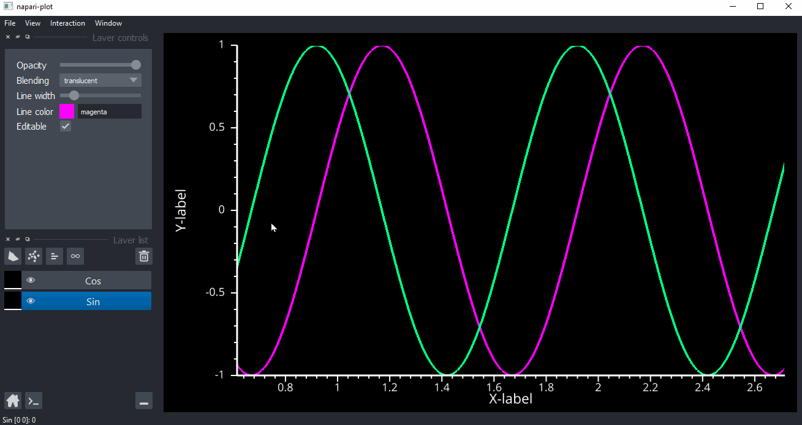
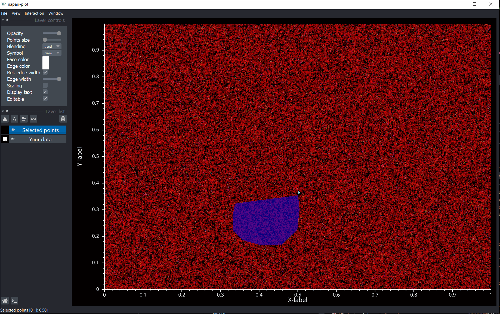

# napari-plot

[](https://github.com/lukasz-migas/napari-plot/raw/main/LICENSE)
[](https://pypi.org/project/napari-plot)
[](https://anaconda.org/conda-forge/napari-plot)
[](https://python.org)
[](https://github.com/lukasz-migas/napari-plot/actions)
[](https://codecov.io/gh/lukasz-migas/napari-plot)
[](https://github.com/pre-commit/pre-commit)
[](https://pypistats.org/packages/napari-plot)
[](https://www.napari-hub.org/plugins/napari-plot)
[](https://napari-plot.readthedocs.io/en/latest/?badge=latest)

## Interactive plotting in napari or a standalone Qt viewer

napari-plot provides GPU-accelerated Line, Scatter, MultiLine, Centroids, Text,
Region, InfLine, and Bar layers. It supports linear, logarithmic, and categorical
axes, an interactive legend, data selection tools, and image display.

## Usage

You can use `napari-plot` alongside `napari` where it is embedded as a dock widget. If using this option, controls are relegated to a toolbar
where you can adjust layer properties like you would do in `napari`.


Or as a standalone app where only one-dimensional plotting is enabled. In this mode, controls take central stage and reflect `napari's` own
behaviour where layer controls are embedded in the main application.



Data selection is also permitted by enabling one of the available selection tools.



## Roadmap

The plotting core includes grid cells with independently configurable axes,
data selection by box, lasso or polygon, and layer-linked legends and colorbars.
The [feature roadmap](TODO/feature-complete-roadmap.md) tracks remaining work,
including per-vertex line colormaps, secondary axes, navigation history, and
deeper links to napari layers.

## Installation

napari-plot requires napari 0.10.x and Python 3.11 or later. Use a Qt6 backend
with `pip install "napari-plot[pyqt6]"` or `pip install "napari-plot[pyside6]"`.
Install `napari-plot[stats]` for seaborn-style statistical plotting.

You can install `napari-plot` directly from PyPI via:

```shell
pip install napari-plot
```

or from the git repo:

```shell
git clone https://github.com/lukasz-migas/napari-plot.git
cd napari-plot
pip install -e '.[all]'
```

The plot widgets open in a tabified bottom dock in napari. Custom layers retain
their individual controls; selecting several layers exposes shared opacity and
blending controls. Built-in-only selections use napari's dynamic controls.

`viewer.scene.camera` and `viewer.canvas.overlays` expose the new model layout.
Existing `viewer.camera`, `viewer.text_overlay`, `viewer.legend`, and
`viewer.grid_lines` accessors refer to the same objects. The custom camera,
log axes, and plot grid remain available.

Layer axis labels automatically populate the plot labels until those labels
are edited explicitly. Unspecified text and legend font sizes follow the
application's appearance font size; pass a number to fix the size.

Python 3.11 or later is required. See the
[documentation](https://napari-plot.readthedocs.io/) for standalone and embedded
quick starts, layer examples, axis controls, interactions, and the public API.

## Contributing

Contributions are very welcome. Install the test environment and run the tests with [uv]:

```shell
uv sync --no-dev --group test --extra pyqt6 --extra optional
uv run --no-sync pytest
```

Please ensure the coverage at least stays the same before you submit a pull request.

## License

Distributed under the terms of the [BSD-3] license,
"napari-plot" is free and open source software

## Issues

If you encounter any problems, please [file an issue] along with a detailed description.

## Support

This project is supported by a Chan-Zuckerberg Initiative [napari](https://chanzuckerberg.com/science/programs-resources/imaging/napari/maintain-1d-visualization-plugin/) grant.

[napari]: https://github.com/napari/napari
[Cookiecutter]: https://github.com/audreyr/cookiecutter
[@napari]: https://github.com/napari
[BSD-3]: http://opensource.org/licenses/BSD-3-Clause
[Apache Software License 2.0]: http://www.apache.org/licenses/LICENSE-2.0
[cookiecutter-napari-plugin]: https://github.com/napari/cookiecutter-napari-plugin
[file an issue]: https://github.com/lukasz-migas/napari-plot/issues
[napari]: https://github.com/napari/napari
[uv]: https://docs.astral.sh/uv/
[pip]: https://pypi.org/project/pip/
[PyPI]: https://pypi.org/
