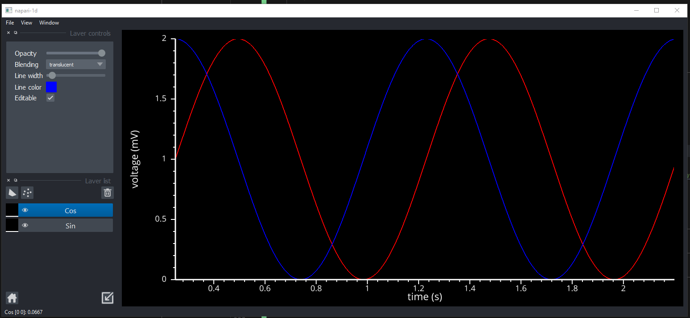
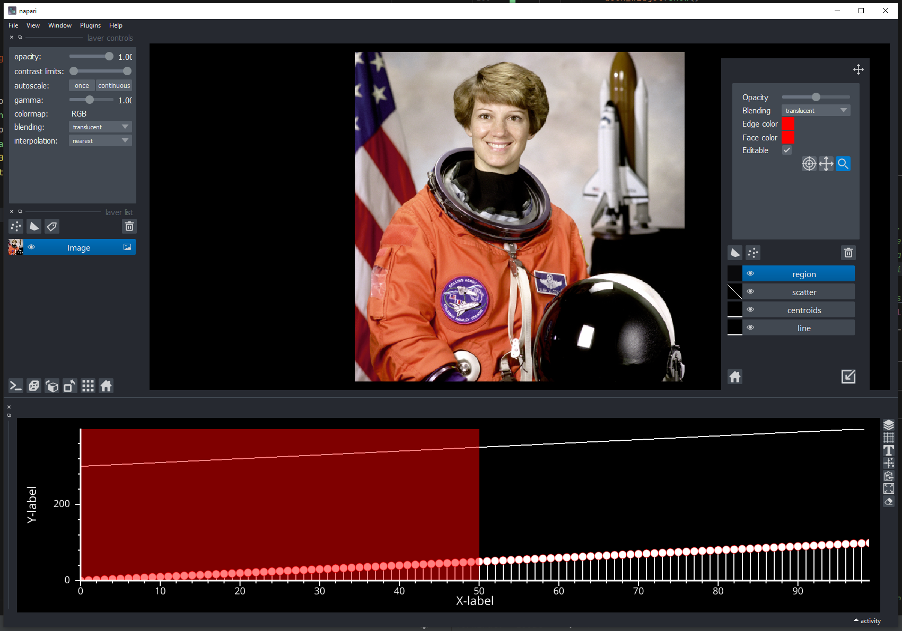
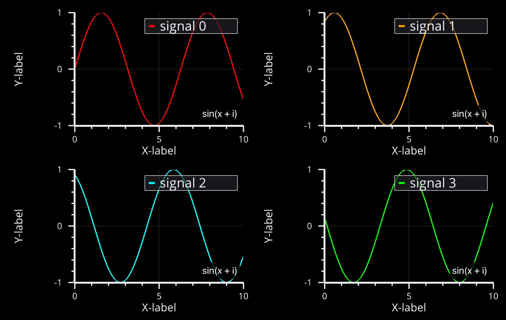
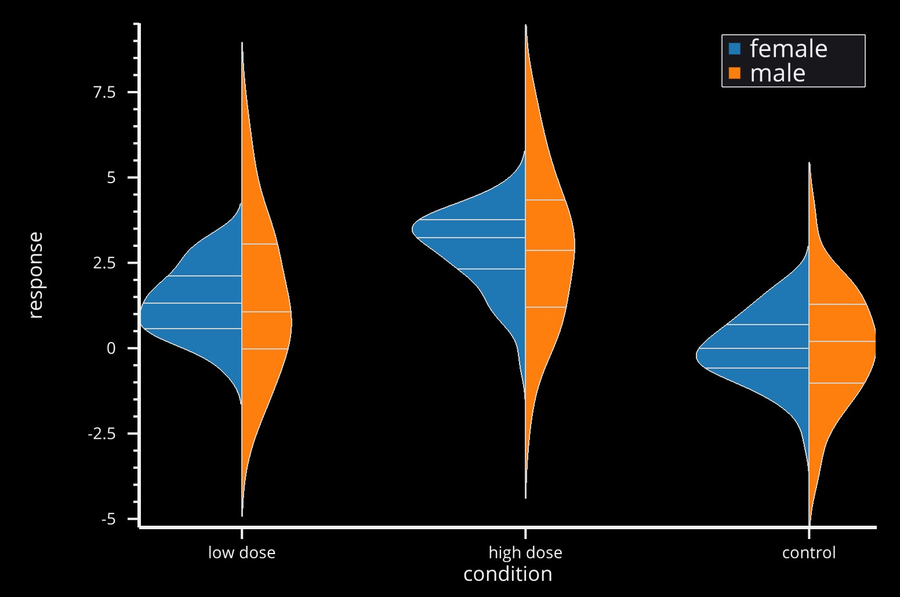
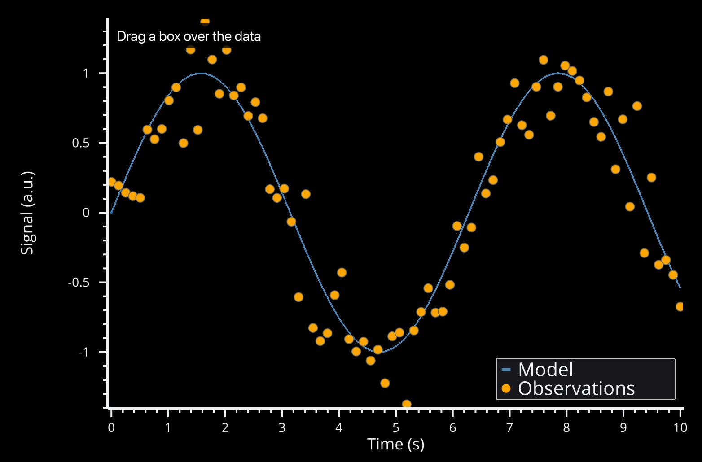

# napari-plot

[](https://github.com/lukasz-migas/napari-plot/raw/main/LICENSE)
[](https://pypi.org/project/napari-plot)
[](https://anaconda.org/conda-forge/napari-plot)
[](https://python.org)
[](https://github.com/lukasz-migas/napari-plot/actions)
[](https://codecov.io/gh/lukasz-migas/napari-plot)
[](https://github.com/pre-commit/pre-commit)
[](https://pypistats.org/packages/napari-plot)
[](https://www.napari-hub.org/plugins/napari-plot)
[](https://lukasz-migas.github.io/napari-plot/)

## Interactive plotting in napari and Qt

napari-plot is a GPU-accelerated plotting library for interactive one-dimensional data visualization. Use it as a dock
widget in napari or open its standalone Qt viewer. Build plots from familiar layers, update them as data changes, and
inspect values with selection tools.



## See it in action

The same plot viewer can be embedded in napari alongside image and annotation layers:



Compare channels or measurements with grid layouts, independently configurable axes, and colorbars:



Statistical plots include categorical distributions and relational plots. Install the `stats` extra to use them:



Selection tools can report the data points and layer indices inside a box, lasso, or polygon selection:



Browse the [example gallery](https://lukasz-migas.github.io/napari-plot/gallery/) for more screenshots and runnable code.

## Current capabilities

- **Plot layers:** Line, Scatter, MultiLine, Centroids, Bar, Band, ErrorBar, Region, InfLine, Rectangles, Text, and Image.
- **Axes and layout:** linear, logarithmic, categorical, and datetime axes; grid views; plot annotations; legends and colorbars.
- **Interaction:** box, lasso, and polygon selection; editable layers; live updates; and shared layer controls in napari.
- **Statistics:** seaborn-style relational, categorical, distribution, matrix, and faceted plots through the optional `stats` extra.
- **Files:** export figures as PNG, SVG, or PDF; export layer data; and save or restore plot sessions.

## Quick start

Install napari-plot with one Qt6 backend. Python 3.11 or later and napari 0.10.x are required.

```shell
pip install "napari-plot[pyqt6]"
```

For PySide6, use `napari-plot[pyside6]`. Add `,stats` to either extra to install statistical plotting support.

Create a plot in the standalone viewer:

```python
import numpy as np
import napari_plot

viewer = napari_plot.Viewer(title="Signal")
x = np.linspace(0, 2 * np.pi, 500)
y = np.sin(x)

viewer.plot(x, y, name="signal", color="cyan")
viewer.scatter(x[::25], y[::25], name="samples", size=8)
viewer.axis.x_label = "Time (s)"
viewer.axis.y_label = "Amplitude"
viewer.legend.visible = True

napari_plot.run()
```

To open it inside napari, add the Plot Widget from **Plugins > napari-plot: Plot Widget**, or create it in Python:

```python
import napari
from napari_plot import NapariPlotWidget

viewer = napari.Viewer()
viewer.window.add_dock_widget(NapariPlotWidget(viewer))
napari.run()
```

## Documentation

See the [quickstart](https://lukasz-migas.github.io/napari-plot/), [layer guide](https://lukasz-migas.github.io/napari-plot/layers/),
[examples](https://lukasz-migas.github.io/napari-plot/examples/), and [API reference](https://lukasz-migas.github.io/napari-plot/api/).

## Contributing

Contributions are welcome. Install the test environment and run the tests with [uv]:

```shell
uv sync --no-dev --group test --extra pyqt6 --extra optional
uv run --no-sync pytest
```

## License

Distributed under the terms of the [BSD-3] license, napari-plot is free and open source software.

## Issues and support

If you encounter a problem, [file an issue](https://github.com/lukasz-migas/napari-plot/issues) with a detailed description.
This project is supported by a Chan-Zuckerberg Initiative [napari](https://chanzuckerberg.com/science/programs-resources/imaging/napari/maintain-1d-visualization-plugin/) grant.

[BSD-3]: http://opensource.org/licenses/BSD-3-Clause
[uv]: https://docs.astral.sh/uv/
