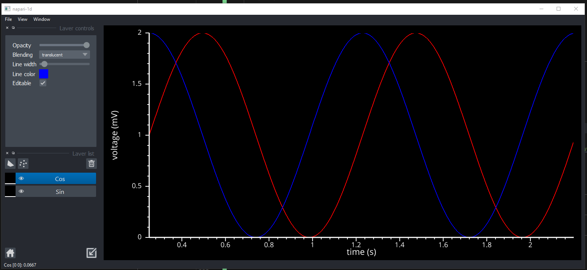

# Examples



Browse the [screenshot gallery](gallery.md) to see the output and open each
example's source code. Gallery screenshots are rendered from the same scripts
listed below.

Run any script with the corresponding Qt backend installed. For example:

```shell
uv run --extra pyqt6 python examples/add_bars_and_legend.py
```

## Axes, editing, and export

| Workflow | Example |
| --- | --- |
| Reference lines and spans, a horizontal fill, stems, a rectangle, and an arrow label | [add_plot_annotations.py](https://github.com/lukasz-migas/napari-plot/blob/main/examples/add_plot_annotations.py) |
| Stacked areas, an uneven-bin histogram, and horizontal bars with a baseline | [add_summary_plots.py](https://github.com/lukasz-migas/napari-plot/blob/main/examples/add_summary_plots.py) |
| Shared datetime axis, independent y axes, and two Scatter colorbars | [grid_axes_and_colorbars.py](https://github.com/lukasz-migas/napari-plot/blob/main/examples/grid_axes_and_colorbars.py) |
| Box, lasso, and polygon selection with counts and indices for two layers | [select_data.py](https://github.com/lukasz-migas/napari-plot/blob/main/examples/select_data.py) |
| Add and move points, edit rectangles, move labels, and delete bars | [edit_layers.py](https://github.com/lukasz-migas/napari-plot/blob/main/examples/edit_layers.py) |
| Export a figure, its data, and an ROI, then reopen a session | [export_and_restore.py](https://github.com/lukasz-migas/napari-plot/blob/main/examples/export_and_restore.py) |
| Theme-aware axes and an outside legend in an embedded plot | [napari-and-1d-themed-legend.py](https://github.com/lukasz-migas/napari-plot/blob/main/examples_with_napari/napari-and-1d-themed-legend.py) |
| Compare profiles from two image channels in a docked plot | [napari-and-1d-channel-profiles.py](https://github.com/lukasz-migas/napari-plot/blob/main/examples_with_napari/napari-and-1d-channel-profiles.py) |

The export example writes PNG, SVG, PDF, CSV, an ROI image, and a
`.napari-plot` session into a new directory. Use `--reopen` to inspect the restored
plot, or drag the session file into a viewer later.

```shell
uv run --extra pyqt6 python examples/export_and_restore.py ./profile-exports --reopen
```

## Statistical plots

| Workflow | Example |
| --- | --- |
| Grouped line styles and widths, a step histogram, normalized KDE, and ECDF | [stats_styled_lines.py](https://github.com/lukasz-migas/napari-plot/blob/main/examples/stats_styled_lines.py) |
| Regression by batch, categorical comparisons, and joint or pairwise views | [stats_facets.py](https://github.com/lukasz-migas/napari-plot/blob/main/examples/stats_facets.py) |
| Cycling rides on a PairGrid with scatter plots, density estimates, and histograms | [stats_pairgrid.py](https://github.com/lukasz-migas/napari-plot/blob/main/examples/stats_pairgrid.py) |

The statistical examples require the `stats` extra. The faceting example defaults
to regression. Use `--kind` to try `ecdf`, `point`, `count`, `pair`, `joint-hist`,
or `joint-kde`.

```shell
uv run --extra pyqt6 --extra stats python examples/stats_facets.py --kind joint-kde
```

## More layer examples

| Plot | Example |
| --- | --- |
| Line with reference spans | [add_lines_and_span.py](https://github.com/lukasz-migas/napari-plot/blob/main/examples/add_lines_and_span.py) |
| Multiple line series | [add_multiline.py](https://github.com/lukasz-migas/napari-plot/blob/main/examples/add_multiline.py) |
| Centroids | [add_centroids.py](https://github.com/lukasz-migas/napari-plot/blob/main/examples/add_centroids.py) |
| Bars with an interactive legend | [add_bars_and_legend.py](https://github.com/lukasz-migas/napari-plot/blob/main/examples/add_bars_and_legend.py) |
| Scatter with labels | [add_scatter_with_text.py](https://github.com/lukasz-migas/napari-plot/blob/main/examples/add_scatter_with_text.py) |
| Lasso-select and highlight scatter points | [add_scatter.py](https://github.com/lukasz-migas/napari-plot/blob/main/examples/add_scatter.py) |
| Several curves in one MultiLine layer | [add_multiline.py](https://github.com/lukasz-migas/napari-plot/blob/main/examples/add_multiline.py) |
| Text annotations | [add_text.py](https://github.com/lukasz-migas/napari-plot/blob/main/examples/add_text.py) |
| Rectangle outlines | [add_rectangles.py](https://github.com/lukasz-migas/napari-plot/blob/main/examples/add_rectangles.py) |
| Filled bands and error bars | [add_band.py](https://github.com/lukasz-migas/napari-plot/blob/main/examples/add_band.py), [add_error_bars.py](https://github.com/lukasz-migas/napari-plot/blob/main/examples/add_error_bars.py) |
| Grid mode | [show_grid_mode.py](https://github.com/lukasz-migas/napari-plot/blob/main/examples/show_grid_mode.py) |
| Log and categorical axes | [add_logarithmic_axes.py](https://github.com/lukasz-migas/napari-plot/blob/main/examples/add_logarithmic_axes.py), [add_categorical_axes.py](https://github.com/lukasz-migas/napari-plot/blob/main/examples/add_categorical_axes.py) |
| Heatmap with a colorbar | [stats_heatmap.py](https://github.com/lukasz-migas/napari-plot/blob/main/examples/stats_heatmap.py) |
| Histograms and KDE | [stats_distributions.py](https://github.com/lukasz-migas/napari-plot/blob/main/examples/stats_distributions.py) |
| Embedded viewer | [examples_with_napari](https://github.com/lukasz-migas/napari-plot/tree/main/examples_with_napari) |
