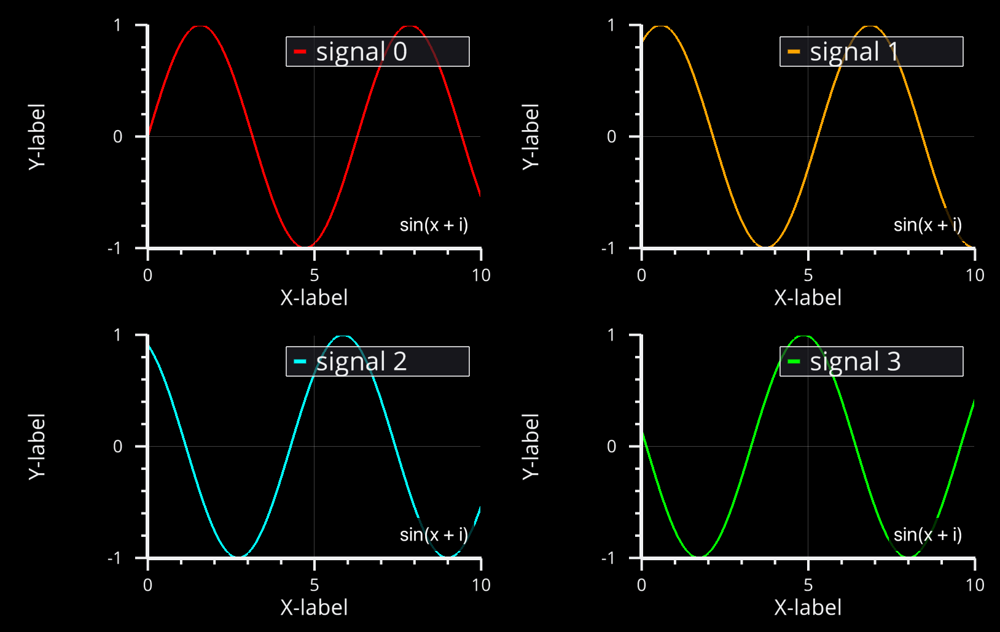
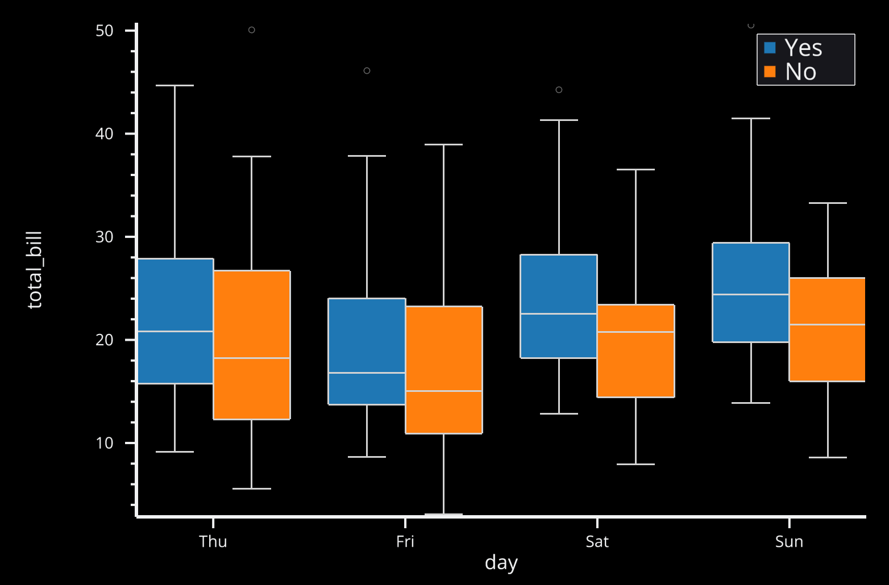

# In-depth explanations

This page covers behavior shared across plot layers: axes, navigation, selection,
grid cells, overlays, and file output.

## Axes and coordinates

The convenience methods `plot(x, y)` and `scatter(x, y)` accept ordinary x and
y arrays. The lower-level napari-style point layers store coordinates in
`(y, x)` order. Keep this distinction in mind when constructing a layer
directly or reading its data back.

```python
viewer.axis.x_label = "Time (s)"
viewer.axis.y_label = "Intensity"
viewer.axis.x_scale = "log"
viewer.xlim = (10, 0)  # Reverse the x direction.
```

Axes support linear, logarithmic, power, datetime, and categorical scales.
Logarithmic coordinates must be positive. Set category labels in display order;
assigning categories also selects a categorical scale.

```python
viewer.axis.x_categories = ("control", "treated", "recovery")
viewer.axis.y_tick_formatter = lambda value: f"{value:.1f} mV"
```

Datetime axes use numeric seconds relative to an origin. A nearby origin helps
preserve precision for short intervals. Custom tick formatter callables are
runtime Python objects and are not saved in session files.

## Navigation and selection

The toolbar provides automatic, box, horizontal, and vertical zoom tools. Use
the box, lasso, or polygon selection tool to select compatible data elements.
Selection is limited to visible layers selected in the layer list. The
`selected_data` property on a supported layer contains selected element indices.

Listen to `viewer.events.selection` to react to selections:

```python
def report_selection(event):
    for layer, indices in event.value.items():
        print(layer.name, sorted(indices))

viewer.events.selection.connect(report_selection)
```

Line indices identify vertices. MultiLine indices identify complete lines. In
grid mode, selection is reported for the cell where the user made the selection.
Region, InfLine, and Bar elements also support Shift-click selection.

## Grid cells and grouped layers

Enable `viewer.canvas.grid.enabled` to display groups of layers in separate
cells. By default, visible layers are divided into groups of `stride` layers.
Set `shape` to control the row and column count; `-1` lets napari-plot calculate
the dimension. `sharex` and `sharey` link axis limits across cells.

```python
viewer.canvas.grid.enabled = True
viewer.canvas.grid.sharey = False
cell = viewer.canvas.grid.cell(0, 0)
cell.y_label = "Intensity"
cell.ylim = (0, 1000)
```



Each line gets its own cell in this example. Grid cells can use independent axis
settings while still sharing limits where direct comparison helps.

To overlay related layers in one cell, set `group_by_metadata` and use a shared
string metadata value. The metadata key is `napari_plot.group`:

```python
line.metadata = {**line.metadata, "napari_plot.group": "sample-a"}
points.metadata = {**points.metadata, "napari_plot.group": "sample-a"}
viewer.canvas.grid.group_by_metadata = True
```

Assign a new metadata dictionary to notify the viewer of the change. Visible
layers without a group ID each receive a cell. The layer-list context menu also
has commands to group, add to a group, and ungroup selected layers.

## Legends, colorbars, and overlays

The legend can follow visible named plot layers or use explicit entries. Clicking
a synchronized legend row toggles its layer's visibility. In a grid, legends
show entries for the layers in their cell by default. Set
`viewer.legend.gridded = False` for one combined legend.

```python
viewer.legend.visible = True
viewer.legend.position = "top_right"
viewer.set_legend_from_layers(title="Series", outside=True)
```

`set_colorbar_from_layer` builds a colorbar from an Image or Scatter layer. Image
colorbars follow the image colormap, contrast limits, and gamma. Scatter
colorbars follow the face colormap and face contrast limits. In grid mode, pass
`cell=(row, column)` to attach a colorbar to a cell.

Canvas overlays can share a position. The `overlay_tiling` model controls their
stacking direction and gap. Set an overlay's `gridded` property to draw it in
each grid cell; other overlays remain in the first cell.

## Statistical plots

The `napari_plot.stats` extra provides seaborn-style functions for categorical,
distribution, relational, matrix, and faceted plots. Inputs can be long-form
DataFrames with column names such as `x`, `y`, and `hue`, wide-form tables, or
arrays. Single-plot functions return the created layers. Facet functions return
a grid whose `layers` property contains them.

```python
viewer.boxplot(data, x="day", y="total_bill", hue="smoker")
facets = viewer.catplot(data, x="day", y="total_bill", col="smoker", kind="box")
facets.set_axis_labels(y_var="Total bill")
```



The plotting function creates Bar, MultiLine, and Scatter layers for the box,
whiskers, and outliers. You can restyle or edit those layers through the usual
layer controls.

Functions that create several layers assign a group ID so grid mode can keep the
parts together. Pass `group="study-a"` to share a group across calls. `PairGrid`
maps different functions to the upper, lower, and diagonal cells; `JointGrid`
adds marginal panels above and beside a main plot.

## Export and sessions

Use `screenshot` to capture the current view. `export_figure` and `export_vector`
fit the data temporarily and restore the current view afterward. Vector export
supports SVG and PDF; Image layers remain bitmap data inside those files.

```python
viewer.screenshot("current-view.png")
viewer.export_figure("figure.png", dpi=300)
viewer.export_vector("figure.svg")
viewer.export_csv("measurements", "measurements.csv")
viewer.save_session("experiment.napari-plot")
```

Session files store layer data and plotting attributes, axis and grid settings,
view range, legend, and color scale. Python callback objects such as custom tick
formatters stay in the script and are not serialized. Load a session with
`viewer.load_session("experiment.napari-plot")`; this replaces the current plot.

## napari integration

napari-plot layers appear in napari's layer list and support visibility,
opacity, ordering, duplication, and transforms. The Plot Widget embeds the
standalone plot viewer. The Scatter Widget compares the currently displayed
slices from two Image layers when their displayed shapes match. Add either
widget from the plugin menu or instantiate its widget class in Python.

The package also exposes `ViewerModel` for applications that need the layer and
plot state without constructing the main window. The [public API reference](api.md)
lists the exported names and viewer methods.
