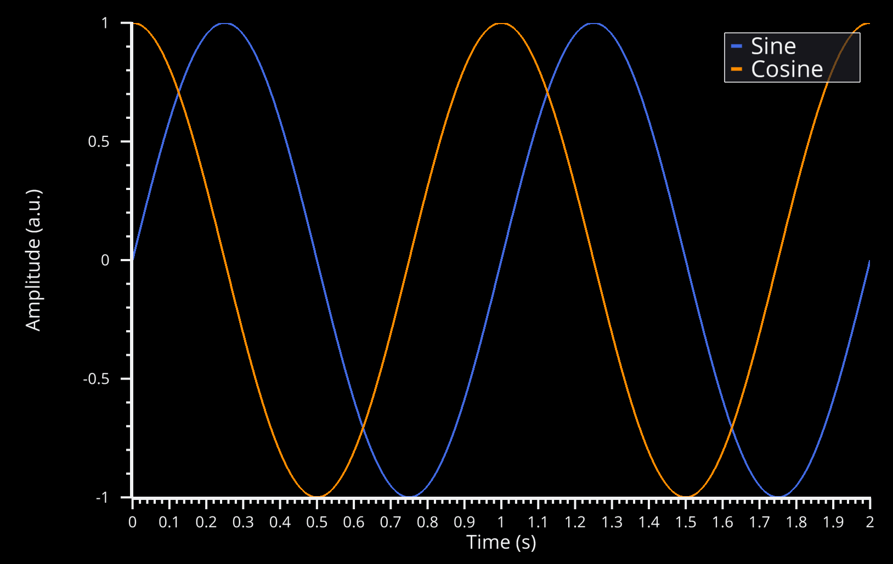
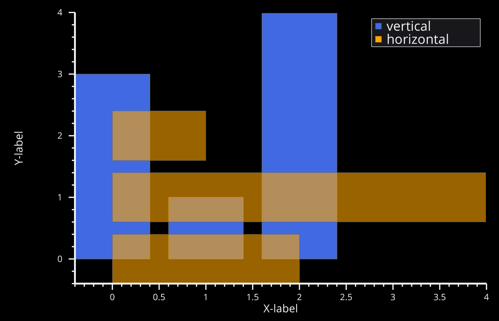
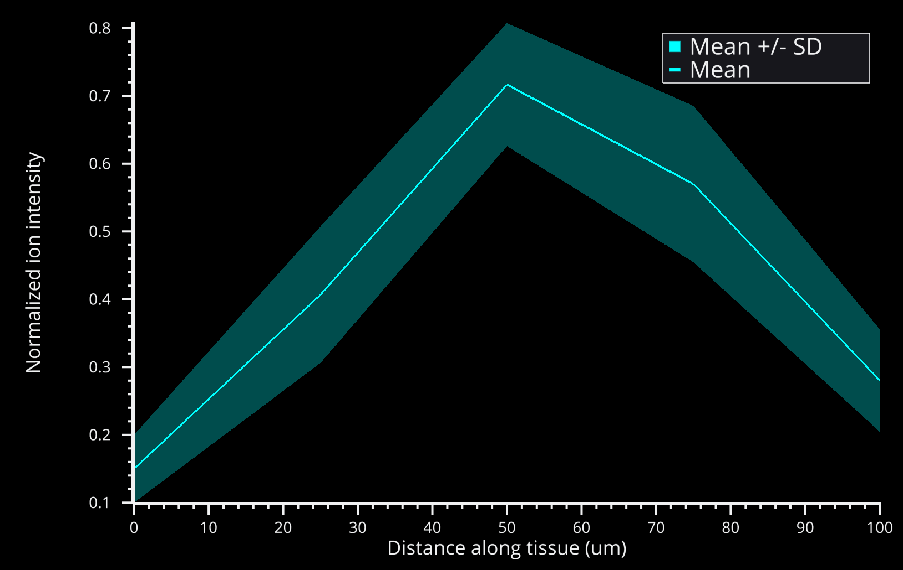
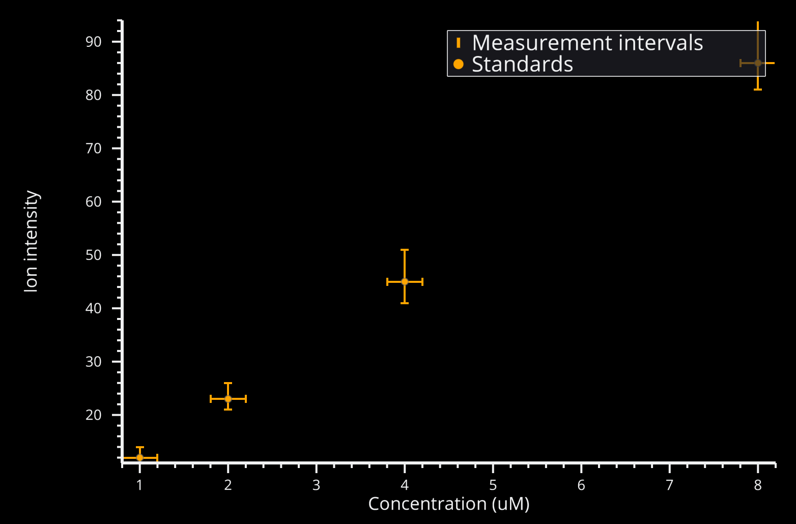
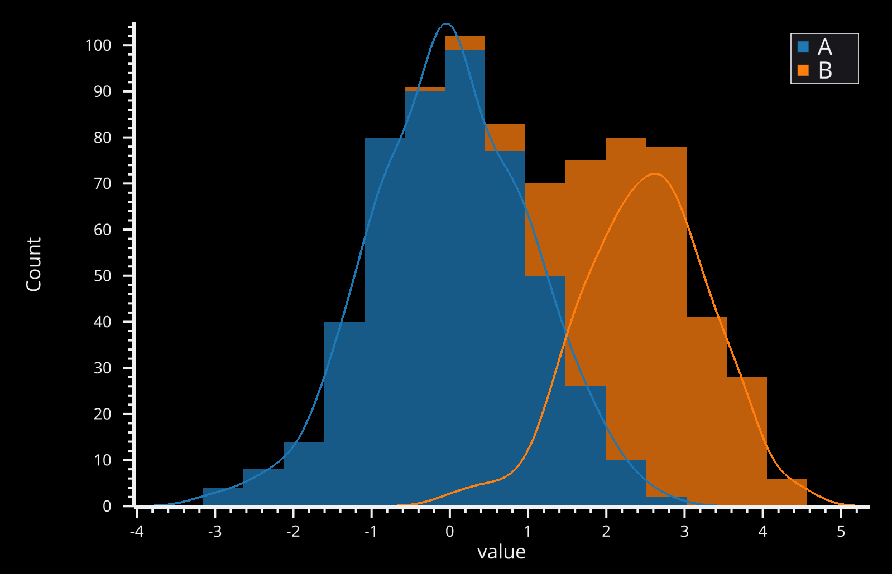
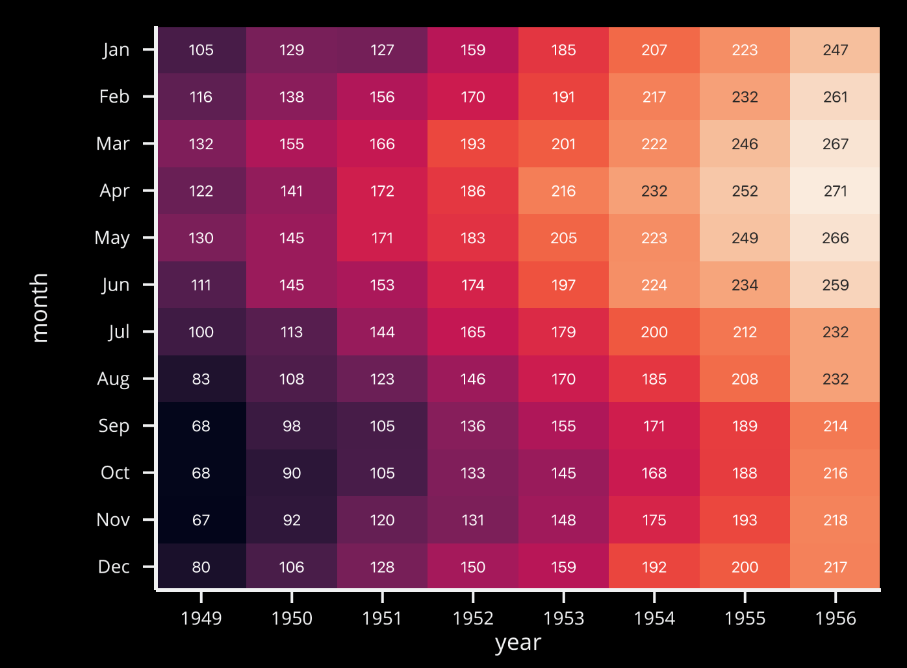

# Example gallery

Each tile shows a figure rendered from its runnable Python example. Select a tile to open the source code on GitHub.

<a class="gallery-card" href="https://github.com/lukasz-migas/napari-plot/blob/main/examples/add_simple_lines.py"><strong>Line plots</strong>Two line series with labeled axes.</a>

<a class="gallery-card" href="https://github.com/lukasz-migas/napari-plot/blob/main/examples/add_scatter_with_text.py"><strong>Scatter and labels</strong>Color points from data features and attach labels.</a>

<a class="gallery-card" href="https://github.com/lukasz-migas/napari-plot/blob/main/examples/add_bars_and_legend.py"><strong>Bars and legend</strong>Compare vertical and horizontal bars with a linked legend.</a>

<a class="gallery-card" href="https://github.com/lukasz-migas/napari-plot/blob/main/examples/add_band.py"><strong>Bands</strong>Show an interval around a measured profile.</a>

<a class="gallery-card" href="https://github.com/lukasz-migas/napari-plot/blob/main/examples/add_error_bars.py"><strong>Error bars</strong>Display asymmetric measurement intervals.</a>

<a class="gallery-card" href="https://github.com/lukasz-migas/napari-plot/blob/main/examples/add_plot_annotations.py"><strong>Annotations</strong>Mark a baseline, integration window, and peak.</a>

<a class="gallery-card" href="https://github.com/lukasz-migas/napari-plot/blob/main/examples/add_rectangles.py"><strong>Rectangles</strong>Mark regions of interest with rectangle layers.</a>

<a class="gallery-card" href="https://github.com/lukasz-migas/napari-plot/blob/main/examples/add_categorical_axes.py"><strong>Categorical axes</strong>Use named categories on both plot axes.</a>

<a class="gallery-card" href="https://github.com/lukasz-migas/napari-plot/blob/main/examples/show_grid_mode.py"><strong>Small multiples</strong>Compare several signals in synchronized plot cells.</a>

<a class="gallery-card" href="https://github.com/lukasz-migas/napari-plot/blob/main/examples/stats_boxplot.py"><strong>Grouped box plots</strong>Compare distributions by day and smoking status.</a>

<a class="gallery-card" href="https://github.com/lukasz-migas/napari-plot/blob/main/examples/stats_distributions.py"><strong>Distributions</strong>Compare stacked histograms with density curves.</a>

<a class="gallery-card" href="https://github.com/lukasz-migas/napari-plot/blob/main/examples/stats_heatmap.py"><strong>Heatmap</strong>Read values from an annotated image layer.</a>

