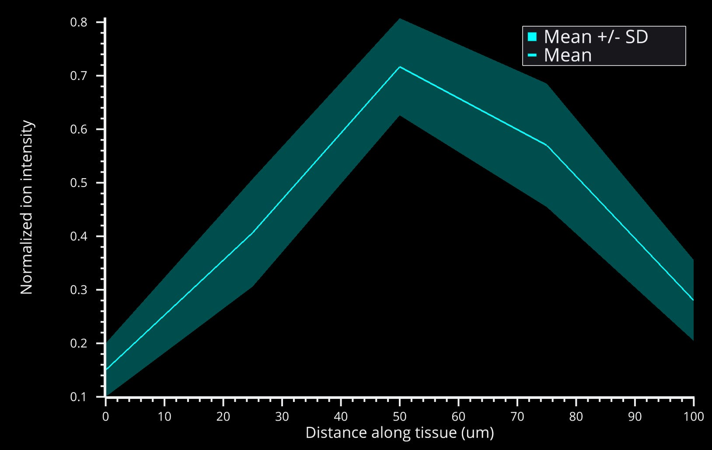

# Add Band

Show a mean tissue profile and its variation across replicate profiles.

**Tags:** `lines`



[View the source file on GitHub](https://github.com/lukasz-migas/napari-plot/blob/main/examples/add_band.py)

## Python example

```python
"""Add Band
========

Show a mean tissue profile and its variation across replicate profiles.

.. tags:: lines
"""

import numpy as np

import napari_plot

distance = np.array([0, 25, 50, 75, 100])
profiles = np.array(
    [
        [0.10, 0.30, 0.62, 0.45, 0.20],
        [0.15, 0.42, 0.73, 0.58, 0.29],
        [0.20, 0.50, 0.80, 0.68, 0.35],
    ]
)
mean = profiles.mean(axis=0)
std = profiles.std(axis=0, ddof=1)

viewer = napari_plot.Viewer()
viewer.axis.x_label = "Distance along tissue (um)"
viewer.axis.y_label = "Normalized ion intensity"
viewer.fill_between(distance, mean - std, mean + std, fill_color="cyan", name="Mean +/- SD")
viewer.plot(distance, mean, color="cyan", name="Mean")
viewer.legend.visible = True

if __name__ == "__main__":
    napari_plot.run()
```
