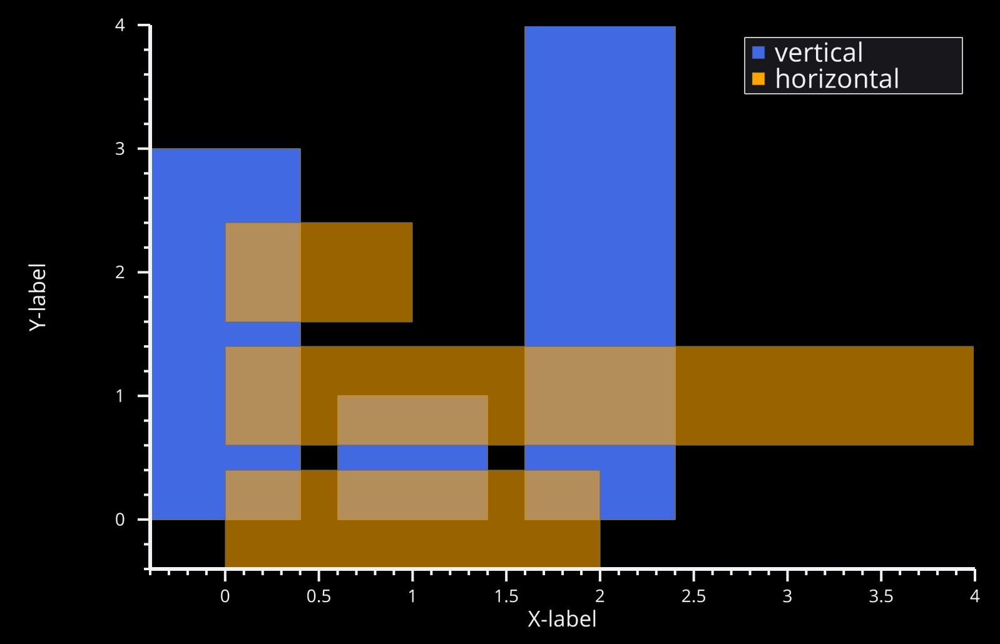

# Add bars and a legend

Show vertical and horizontal bars with the canvas legend.

**Tags:** `bars-and-histograms`



[View the source file on GitHub](https://github.com/lukasz-migas/napari-plot/blob/main/examples/add_bars_and_legend.py)

## Python example

```python
"""Add bars and a legend
===================

Show vertical and horizontal bars with the canvas legend.

.. tags:: bars-and-histograms
"""

import napari_plot

viewer1d = napari_plot.Viewer()
viewer1d.vbar([0, 1, 2], [3, 1, 4], name="vertical", fill_color="royalblue")
viewer1d.hbar([0, 1, 2], [2, 4, 1], name="horizontal", fill_color="orange", opacity=0.6)
viewer1d.legend.visible = True

if __name__ == "__main__":
    napari_plot.run()
```
