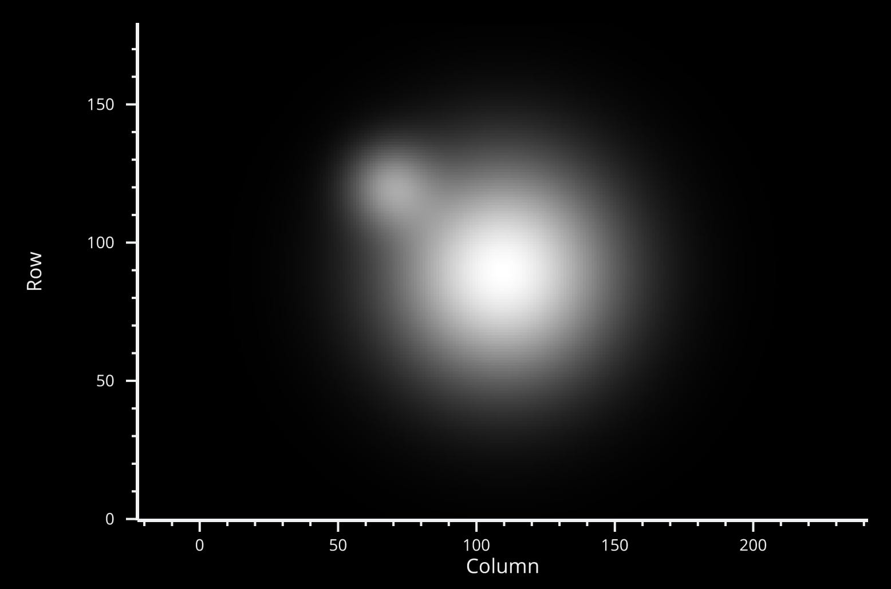

# Add Image

Display a scalar image with physical axis labels and square pixels.

**Tags:** `images`



[View the source file on GitHub](https://github.com/lukasz-migas/napari-plot/blob/main/examples/add_image.py)

## Python example

```python
"""Add Image
=========

Display a scalar image with physical axis labels and square pixels.

.. tags:: images
"""

import numpy as np

import napari_plot

rows, columns = np.mgrid[-1:1:180j, -1.2:1.2:220j]
image = np.exp(-5 * (rows**2 + columns**2)) + 0.45 * np.exp(-35 * ((rows - 0.35) ** 2 + (columns + 0.45) ** 2))

viewer1d = napari_plot.Viewer()
viewer1d.add_image(image)

# ensure that pixels remain square
viewer1d.camera.aspect = 1
viewer1d.axis.x_label = "Column"
viewer1d.axis.y_label = "Row"

if __name__ == "__main__":
    napari_plot.run()
```
