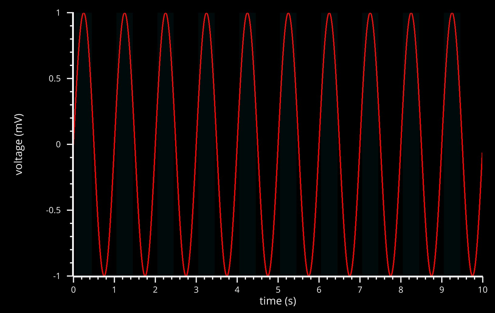

# Add Lines And Span

Example showing how to plot multiple line sand adjust axis labels.

**Tags:** `lines`



[View the source file on GitHub](https://github.com/lukasz-migas/napari-plot/blob/main/examples/add_lines_and_span.py)

## Python example

```python
"""Add Lines And Span
==================

Example showing how to plot multiple line sand adjust axis labels.

.. tags:: lines
"""

import numpy as np

import napari_plot

viewer1d = napari_plot.Viewer()
x = np.arange(0.0, 10.0, 0.01)
y = np.sin(2 * np.pi * x)
pos_x = x[np.where(y == 1.0)]
window = 0.2
viewer1d.add_line(np.c_[x, y], name="Sin", color="#FF0000")
viewer1d.add_region(
    [(p - window, p + window) for p in pos_x],
    orientation="vertical",
    color="#00FFFF",
    opacity=0.2,
    name="Apex windows",
)
viewer1d.axis.x_label = "time (s)"
viewer1d.axis.y_label = "voltage (mV)"

if __name__ == "__main__":
    napari_plot.run()
```
