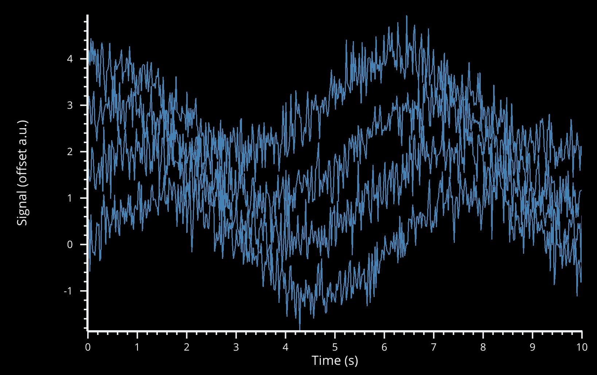

# Add Multiline

Plot several related curves in one MultiLine layer.

**Tags:** `lines`



[View the source file on GitHub](https://github.com/lukasz-migas/napari-plot/blob/main/examples/add_multiline.py)

## Python example

```python
"""Add Multiline
=============

Plot several related curves in one MultiLine layer.

.. tags:: lines
"""

import numpy as np

import napari_plot

n_pts = 500
n_lines = 4
x = np.linspace(0, 10, n_pts)
xs = [x for _ in range(n_lines)]
rng = np.random.default_rng(21)
ys = [np.sin(x + phase) + 0.35 * rng.normal(size=n_pts) + 2 * phase for phase in (0, 0.5, 1, 1.5)]

viewer1d = napari_plot.Viewer()
viewer1d.add_multi_line({"xs": xs, "ys": ys}, name="Replicate signals", color="steelblue", width=1.5)
viewer1d.axis.x_label = "Time (s)"
viewer1d.axis.y_label = "Signal (offset a.u.)"

if __name__ == "__main__":
    napari_plot.run()
```
