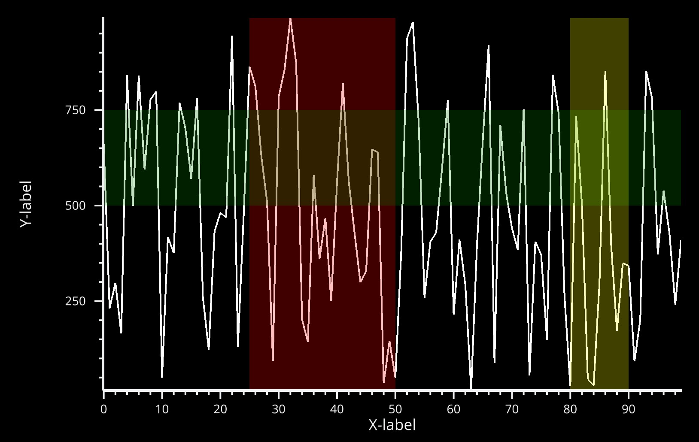

# Multiple regions

Multiple infinite regions in a single layer.

**Tags:** `plotting`



[View the source file on GitHub](https://github.com/lukasz-migas/napari-plot/blob/main/examples/add_multiple_regions.py)

## Python example

```python
"""Multiple regions
====================

Multiple infinite regions in a single layer.

.. tags:: plotting
"""

import numpy as np

import napari_plot

viewer1d = napari_plot.Viewer()
viewer1d.add_line(np.c_[np.arange(100), np.random.default_rng().integers(0, 1000, 100)], name="line")

regions = [
    ([25, 50], "vertical"),
    ([500, 750], "horizontal"),
    ([80, 90], "vertical"),
]

layer = viewer1d.add_region(
    regions,
    color=["red", "green", "yellow"],
    opacity=0.5,
    name="Infinite Region",
)
if __name__ == "__main__":
    napari_plot.run()
```
