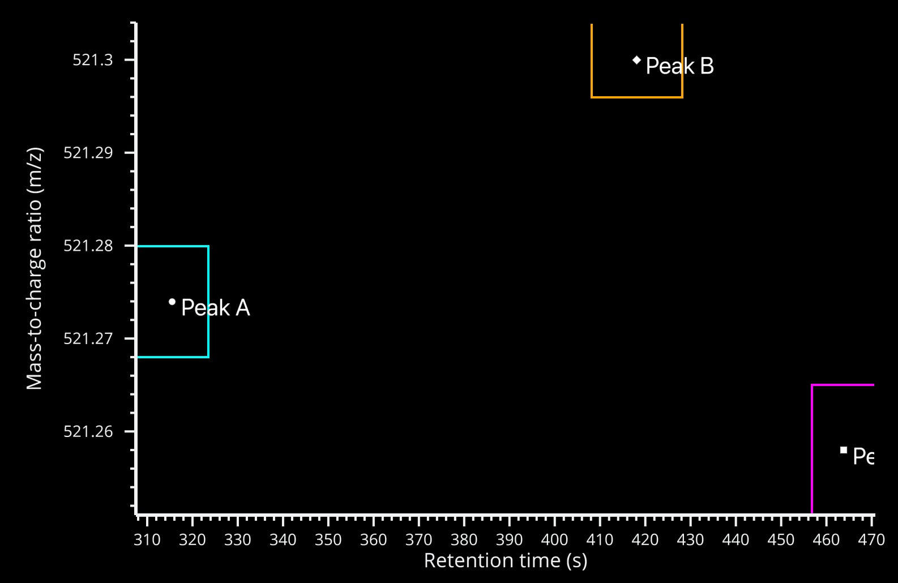

# Add Rectangles

Display mass spectrometry peak windows with center markers and labels.

**Tags:** `plotting`



[View the source file on GitHub](https://github.com/lukasz-migas/napari-plot/blob/main/examples/add_rectangles.py)

## Python example

```python
"""Add Rectangles
==============

Display mass spectrometry peak windows with center markers and labels.

.. tags:: plotting
"""

import napari_plot

viewer = napari_plot.Viewer()
viewer.axis.x_label = "Retention time (s)"
viewer.axis.y_label = "Mass-to-charge ratio (m/z)"

peaks = viewer.add_rectangles(
    centers=[[315.5, 521.274], [418.1, 521.300], [463.8, 521.258]],
    height=[0.012, 0.008, 0.014],
    width=[16.0, 20.0, 14.0],
    name="Peak windows",
    outline_width=2,
    outline_color=["cyan", "orange", "magenta"],
    show_rectangles=True,
    show_markers=True,
    show_text=True,
    marker_size=[6, 8, 6],
    marker_symbol=["disc", "diamond", "square"],
    text=["Peak A", "Peak B", "Peak C"],
    text_offset=(2, 0.001),
)

# Toggle outlines, markers, and labels independently in the layer controls.
if __name__ == "__main__":
    napari_plot.run()
```
