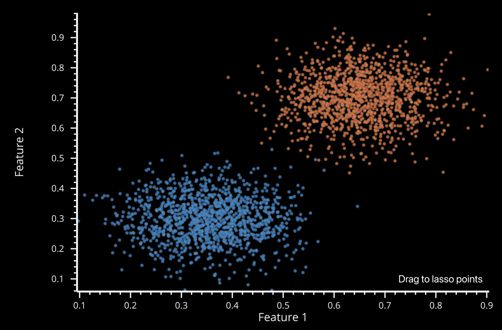

# Add Scatter

Use the lasso drag tool to select and highlight scatter points.

**Tags:** `scatter`



[View the source file on GitHub](https://github.com/lukasz-migas/napari-plot/blob/main/examples/add_scatter.py)

## Python example

```python
"""Add Scatter
===========

Use the lasso drag tool to select and highlight scatter points.

.. tags:: scatter
"""

import numpy as np

import napari_plot


def select_data(event):
    """Select data"""
    indices = layer._get_mask_from_path(event.value, as_indices=True)
    data = yx[indices, :]
    sel_layer.data = data


n = 2500
rng = np.random.default_rng(12)
yx = np.concatenate((rng.normal((0.3, 0.35), 0.08, (n // 2, 2)), rng.normal((0.7, 0.65), 0.08, (n // 2, 2))))
viewer1d = napari_plot.Viewer()
viewer1d.drag_tool.active = "lasso"
viewer1d.drag_tool.events.vertices.connect(select_data)
layer = viewer1d.add_scatter(
    yx,
    face_color=np.where(np.arange(n)[:, None] < n // 2, [0.2, 0.55, 0.9, 0.8], [0.95, 0.45, 0.2, 0.8]),
    size=5,
    scaling=False,
    name="Your data",
)
sel_layer = viewer1d.add_scatter(
    None,
    scaling=False,
    face_color="yellow",
    border_color="green",
    size=10,
    name="Selected points",
)
viewer1d.axis.x_label = "Feature 1"
viewer1d.axis.y_label = "Feature 2"
viewer1d.text_overlay.text = "Drag to lasso points"
viewer1d.text_overlay.visible = True
if __name__ == "__main__":
    napari_plot.run()
```
