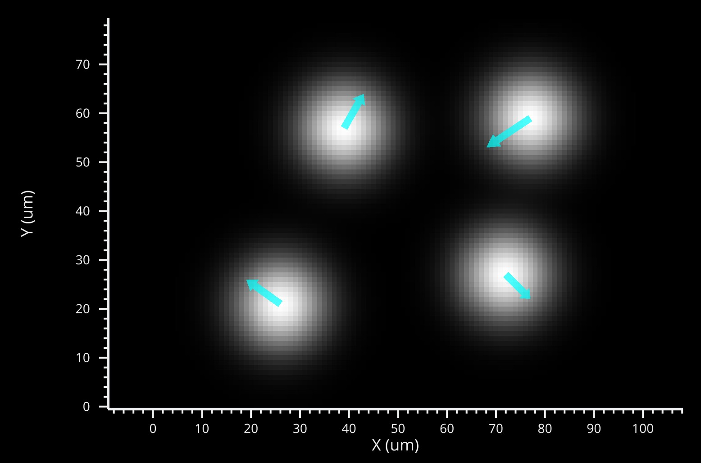

# Add Vectors

Overlay registration residuals on a synthetic image.

**Tags:** `images`



[View the source file on GitHub](https://github.com/lukasz-migas/napari-plot/blob/main/examples/add_vectors.py)

## Python example

```python
"""Add Vectors
===========

Overlay registration residuals on a synthetic image.

.. tags:: images
"""

import numpy as np

import napari_plot

starts = np.array([[21, 26], [27, 72], [57, 39], [59, 77]])
displacements = np.array([[5, -7], [-5, 5], [7, 4], [-6, -9]])
rows, columns = np.indices((80, 100))
image = sum(np.exp(-((rows - y) ** 2 + (columns - x) ** 2) / 80) for y, x in starts)

viewer = napari_plot.Viewer()
viewer.axis.x_label = "X (um)"
viewer.axis.y_label = "Y (um)"
viewer.camera.aspect = 1
viewer.add_image(image, name="Reference landmarks", units=("um", "um"))
# Native napari vectors store (y, x) starts and (dy, dx) displacements.
viewer.add_vectors(
    np.stack((starts, displacements), axis=1),
    vector_style="arrow",
    edge_color="cyan",
    edge_width=1.5,
    length=1,
    name="Registration residuals",
    units=("um", "um"),
)

if __name__ == "__main__":
    napari_plot.run()
```
