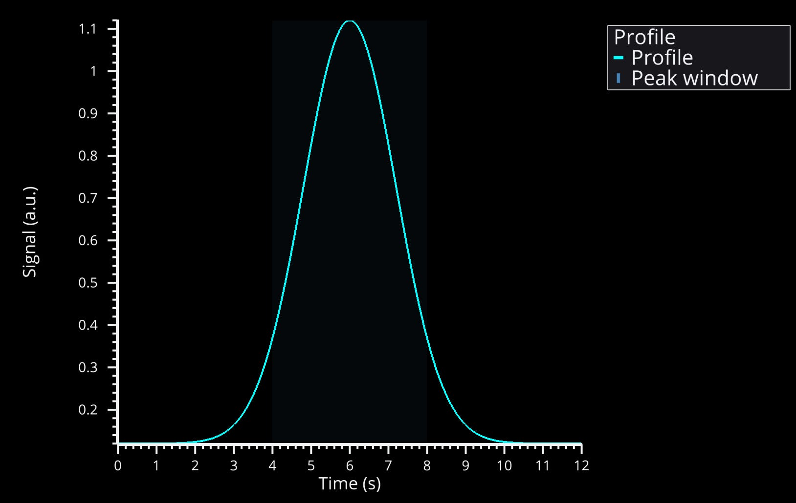

# Export and restore a plot

Export a synthetic profile as PNG, SVG, PDF, CSV, ROI, and a plot session.

**Tags:** `export`



[View the source file on GitHub](https://github.com/lukasz-migas/napari-plot/blob/main/examples/export_and_restore.py)

## Python example

```python
"""Export and restore a plot
==================

Export a synthetic profile as PNG, SVG, PDF, CSV, ROI, and a plot session.

.. tags:: export
"""

from argparse import ArgumentParser
from pathlib import Path

import numpy as np
from qtpy.QtWidgets import QApplication

import napari_plot
from napari_plot.layers import Line

time = np.linspace(0, 12, 300)
signal = 0.12 + np.exp(-0.5 * ((time - 6) / 1.2) ** 2)

viewer = napari_plot.Viewer(title="Exporting a profile")
profile = viewer.plot(time, signal, color="cyan", name="Profile")
viewer.axvspan(4, 8, color="steelblue", opacity=0.25, name="Peak window")
viewer.axis.x_label = "Time (s)"
viewer.axis.y_label = "Signal (a.u.)"
viewer.set_legend_from_layers(title="Profile", outside=True)
viewer.reset_view()


def write_exports(viewer: napari_plot.Viewer, layer: Line, output: Path) -> Path:
    """Write the figure and data to a new directory and return the session file."""
    output.mkdir(parents=True)
    QApplication.processEvents()
    viewer.export_figure(output / "profile.png", dpi=144)
    viewer.export_vector(output / "profile.svg")
    viewer.export_vector(output / "profile.pdf")
    viewer.export_csv(layer, output / "profile.csv")
    # ROI corners are in world (y, x) order.
    roi = np.array([[0, 4], [0, 8], [1.3, 8], [1.3, 4]])
    viewer.export_rois([roi], paths=output / "regions")
    session = output / "profile.napari-plot"
    viewer.save_session(session)
    return session


if __name__ == "__main__":
    parser = ArgumentParser(description=__doc__)
    parser.add_argument("output", type=Path, help="New directory for the exported files.")
    parser.add_argument("--reopen", action="store_true", help="Open the saved session in a second window.")
    args = parser.parse_args()
    if args.output.exists():
        parser.error(f"Output directory already exists: {args.output}")
    session = write_exports(viewer, profile, args.output)
    print(f"Saved figure, data, and session in {session.parent.resolve()}")
    if args.reopen:
        restored = napari_plot.Viewer(title="Restored profile")
        restored.load_session(session)
    napari_plot.run()
```
