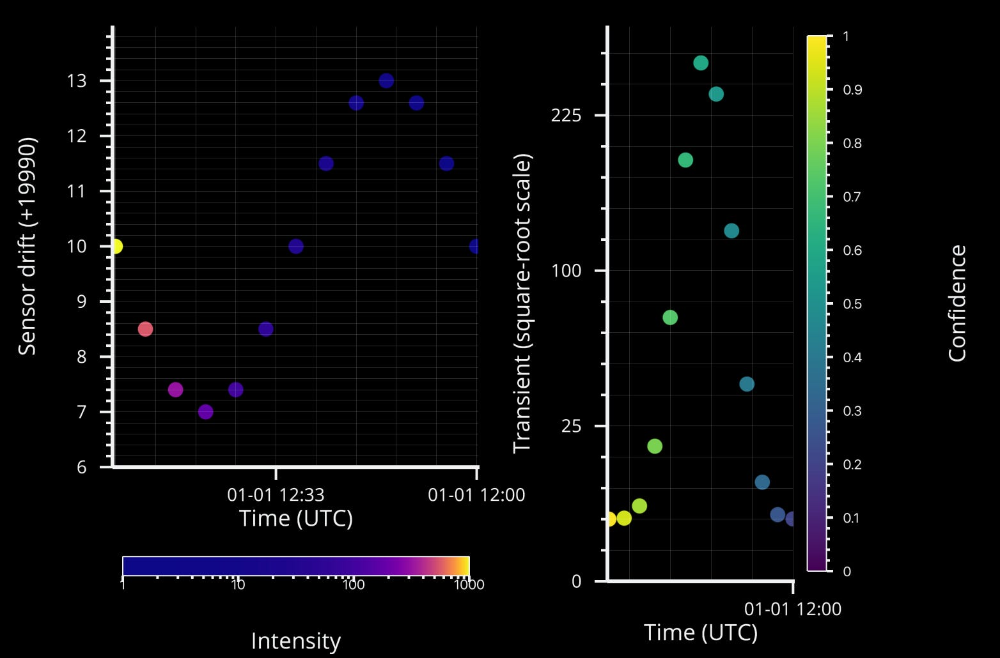

# Grid axes and colorbars

Share an inverted datetime axis across two cells with independent y axes and colorbars.

**Tags:** `bars-and-histograms`, `layouts`



[View the source file on GitHub](https://github.com/lukasz-migas/napari-plot/blob/main/examples/grid_axes_and_colorbars.py)

## Python example

```python
"""Grid axes and colorbars
=======================

Share an inverted datetime axis across two cells with independent y axes and colorbars.

.. tags:: bars-and-histograms, layouts
"""

from datetime import UTC, datetime, timedelta

import numpy as np

import napari_plot
from napari_plot.components.axis import datetime_axis_values

origin = datetime(2026, 1, 1, 12, tzinfo=UTC)
timestamps = [origin + timedelta(minutes=5 * index) for index in range(13)]
seconds = datetime_axis_values(timestamps, origin=origin)
phase = np.linspace(0, 2 * np.pi, len(seconds))
drift = 20_000 + 3 * np.sin(phase)
transient = 4 + 280 * np.exp(-((phase - 3) ** 2))
intensity = np.geomspace(1, 1000, len(seconds))
confidence = np.linspace(0.2, 1, len(seconds))

viewer = napari_plot.Viewer(title="Comparing two sensor channels")
viewer.window.resize(1220, 640)
viewer.axis.x_datetime_origin = origin
viewer.axis.x_scale = "datetime"
viewer.axis.x_minor_ticks = False
viewer.axis.y_max_size = 88
viewer.axis.y_label_margin = 57
viewer.axis.y_tick_notation = "offset"
viewer.axis.y_power = 0.5
viewer.grid_lines.visible = True
viewer.grid_lines.minor = True
viewer.grid_lines.opacity = 0.15

grid = viewer.canvas.grid
grid.shape = (1, 2)
grid.spacing = 12
grid.sharex = True
grid.sharey = False
grid.group_by_metadata = True

left = grid.cell(0, 0)
left.group = "drift"
left.x_label = "Time (UTC)"
left.y_label = "Sensor drift"
left.ylim = (19_996, 20_004)

right = grid.cell(0, 1)
right.group = "transient"
right.x_label = "Time (UTC)"
right.y_label = "Transient (square-root scale)"
right.y_scale = "power"
right.ylim = (0, 320)

drift_layer = viewer.scatter(
    seconds,
    drift,
    features={"intensity": intensity},
    face_color="intensity",
    face_colormap="plasma",
    face_contrast_limits=(1, 1000),
    border_width=0,
    size=12,
    scaling=False,
    metadata={"napari_plot.group": "drift"},
    name="Drift",
)
transient_layer = viewer.scatter(
    seconds,
    transient,
    features={"confidence": confidence},
    face_color="confidence",
    face_colormap="viridis",
    face_contrast_limits=(0, 1),
    border_width=0,
    size=12,
    scaling=False,
    metadata={"napari_plot.group": "transient"},
    name="Transient",
)

grid.enabled = True
viewer.set_colorbar_from_layer(drift_layer, "Intensity", cell=(0, 0), position="bottom", norm="log")
viewer.set_colorbar_from_layer(transient_layer, "Confidence", cell=(0, 1), position="right")
viewer.xlim = (3800, -200)  # Descending limits run from latest to earliest.
viewer.autoscale = False

if __name__ == "__main__":
    napari_plot.run()
```
