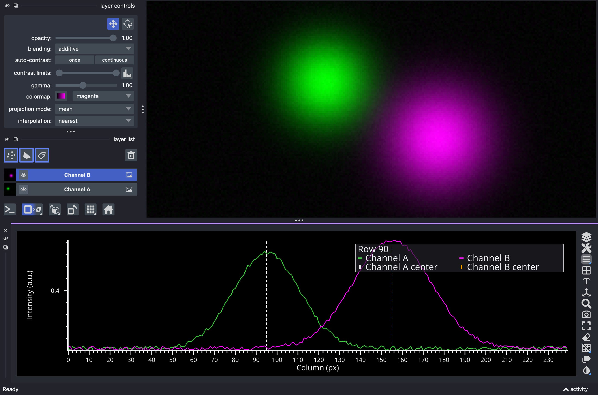

# Compare channel profiles in napari

Compare row profiles from two channels beside a napari image viewer.

**Tags:** `napari-integration`



[View the source file on GitHub](https://github.com/lukasz-migas/napari-plot/blob/main/examples_with_napari/napari-and-1d-channel-profiles.py)

## Python example

```python
"""Compare channel profiles in napari
==============================

Compare row profiles from two channels beside a napari image viewer.

.. tags:: napari-integration
"""

import napari
import numpy as np

from napari_plot import NapariPlotWidget

rng = np.random.default_rng(19)
rows, columns = np.mgrid[0:180, 0:240]
channel_a = np.exp(-((rows - 75) ** 2 + (columns - 95) ** 2) / 500) + 0.03 * rng.random(rows.shape)
channel_b = np.exp(-((rows - 105) ** 2 + (columns - 155) ** 2) / 700) + 0.03 * rng.random(rows.shape)

viewer = napari.Viewer(title="Two channel profiles")
viewer.add_image(channel_a, name="Channel A", colormap="green", blending="additive")
viewer.add_image(channel_b, name="Channel B", colormap="magenta", blending="additive")

widget = NapariPlotWidget(viewer)
viewer.window.add_dock_widget(widget, area="bottom", name="Row profiles")
plot = widget.viewer_plot
row = 90
x = np.arange(channel_a.shape[1])
plot.plot(x, channel_a[row], name="Channel A", color="limegreen")
plot.plot(x, channel_b[row], name="Channel B", color="magenta")
plot.axvline(95, color="white", line_style="dashed", name="Channel A center")
plot.axvline(155, color="orange", line_style="dashed", name="Channel B center")
plot.axis.x_label = "Column (px)"
plot.axis.y_label = "Intensity (a.u.)"
plot.set_legend_from_layers(title=f"Row {row}", ncols=2)
plot.reset_view()

if __name__ == "__main__":
    napari.run()
```
