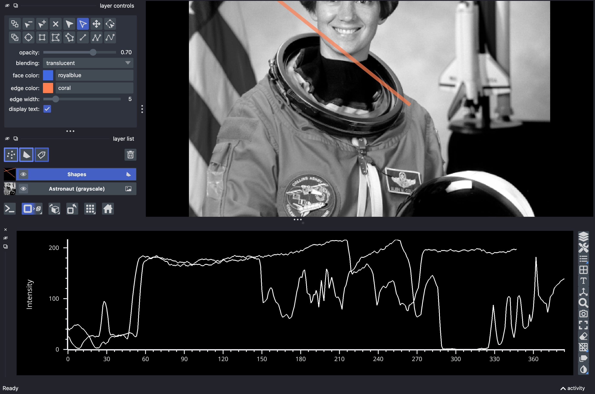

# Update profiles from napari line shapes

Update docked intensity profiles while moving selected image lines.

**Tags:** `napari-integration`, `live-updates`



[View the source file on GitHub](https://github.com/lukasz-migas/napari-plot/blob/main/examples_with_napari/napari-and-1d-live-callback.py)

## Python example

```python
"""Update profiles from napari line shapes
===========================

Update docked intensity profiles while moving selected image lines.

.. tags:: napari-integration, live-updates
"""

import napari
import numpy as np
from skimage import data, measure

import napari_plot
from napari_plot._qt.qt_viewer import QtViewer


def _get_line_data(image: np.ndarray, start: np.ndarray, end: np.ndarray) -> np.ndarray:
    """Sample image intensities along a napari line shape."""
    return measure.profile_line(image, start, end, mode="nearest")


viewer = napari.Viewer()
image = data.astronaut().mean(-1)
viewer.add_image(image, name="Astronaut (grayscale)")
shapes_layer = viewer.add_shapes(
    [np.array([[11, 13], [250, 313]]), np.array([[100, 10], [10, 345]])],
    shape_type="line",
    edge_width=5,
    edge_color="coral",
    face_color="royalblue",
)
shapes_layer.mode = "select"

viewer1d = napari_plot.ViewerModel()
viewer1d.axis.y_label = "Intensity"
viewer1d.axis.x_label = ""
viewer1d.text_overlay.visible = True
viewer1d.text_overlay.position = "top_right"

qt_viewer = QtViewer(viewer1d)

lines = []
for i, line in enumerate(shapes_layer.data):
    y = _get_line_data(image, *line)
    lines.append(viewer1d.add_line(np.c_[np.arange(len(y)), y], name=str(i)))


# hook the lines up to events
def _profile_lines(image, shape_layer):
    # only a single line for this example
    for i, line in enumerate(shape_layer.data):
        if i in shape_layer._selected_data:
            y = _get_line_data(image, *line)
            lines[i].data = np.c_[np.arange(len(y)), y]


@shapes_layer.mouse_drag_callbacks.append
def _profile_lines_drag(layer, event):
    _profile_lines(image, layer)
    yield
    while event.type == "mouse_move":
        _profile_lines(image, layer)
        yield


viewer.window.add_dock_widget(qt_viewer, area="bottom", name="Line Widget")

if __name__ == "__main__":
    napari.run()
```
