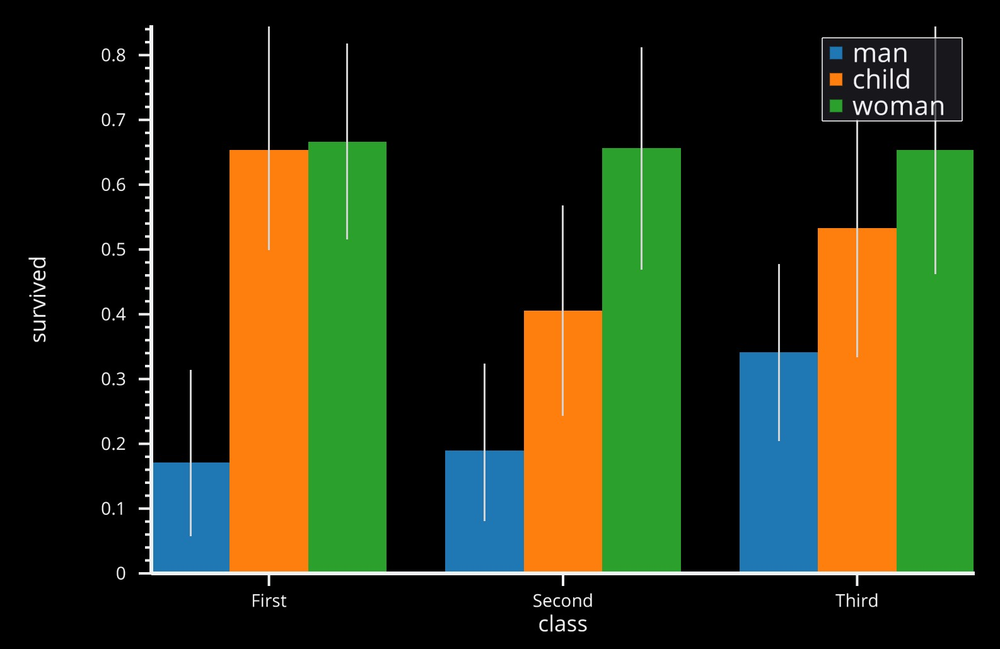

# Grouped bar plots

Estimate means and 95% confidence intervals with bootstrapping.

**Tags:** `statistical-plots`, `bar`



[View the source file on GitHub](https://github.com/lukasz-migas/napari-plot/blob/main/examples/stats_barplot.py)

## Python example

```python
"""Grouped bar plots
=============

Estimate means and 95% confidence intervals with bootstrapping.

.. tags:: statistical-plots, bar"""

import numpy as np
import pandas as pd

import napari_plot

rng = np.random.default_rng(2)
n = 300
frame = pd.DataFrame(
    {
        "class": rng.choice(["First", "Second", "Third"], n),
        "who": rng.choice(["man", "woman", "child"], n),
    }
)
frame["survived"] = rng.random(n) < frame["who"].map({"man": 0.2, "woman": 0.7, "child": 0.5})

viewer = napari_plot.Viewer()
viewer.barplot(frame, x="class", y="survived", hue="who", order=["First", "Second", "Third"], seed=0)

if __name__ == "__main__":
    napari_plot.run()
```
