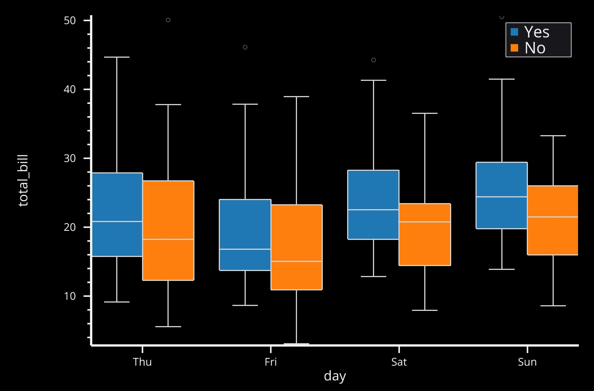

# Grouped box plots

Compare categories in long-form data using a seaborn-style layout.

**Tags:** `statistical-plots`, `box`



[View the source file on GitHub](https://github.com/lukasz-migas/napari-plot/blob/main/examples/stats_boxplot.py)

## Python example

```python
"""Grouped box plots
=============

Compare categories in long-form data using a seaborn-style layout.

.. tags:: statistical-plots, box"""

import numpy as np
import pandas as pd

import napari_plot

rng = np.random.default_rng(42)
days = rng.choice(["Thu", "Fri", "Sat", "Sun"], 240)
smoker = rng.choice(["Yes", "No"], 240)
total_bill = rng.gamma(4, 4, 240) + np.where(smoker == "Yes", 4, 0) + np.where(np.isin(days, ["Sat", "Sun"]), 5, 0)
tips = pd.DataFrame({"day": days, "smoker": smoker, "total_bill": total_bill})

viewer = napari_plot.Viewer()
viewer.boxplot(tips, x="day", y="total_bill", hue="smoker", order=["Thu", "Fri", "Sat", "Sun"])

if __name__ == "__main__":
    napari_plot.run()
```
