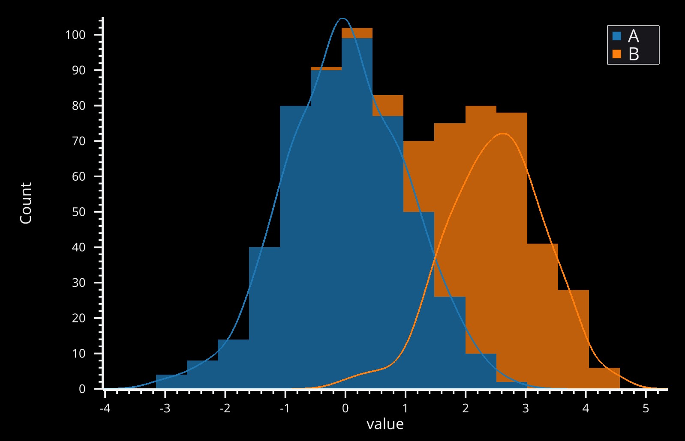

# Distributions

Stacked histogram with KDE overlays, split by group.

**Tags:** `statistical-plots`, `distribution`



[View the source file on GitHub](https://github.com/lukasz-migas/napari-plot/blob/main/examples/stats_distributions.py)

## Python example

```python
"""Distributions
===================

Stacked histogram with KDE overlays, split by group.

.. tags:: statistical-plots, distribution
"""

import numpy as np
import pandas as pd

import napari_plot

rng = np.random.default_rng(4)
frame = pd.DataFrame(
    {
        "value": np.concatenate((rng.normal(0, 1, 500), rng.normal(2.5, 0.8, 300))),
        "group": ["A"] * 500 + ["B"] * 300,
    }
)

viewer = napari_plot.Viewer()
viewer.histplot(frame, x="value", hue="group", multiple="stack", kde=True)

if __name__ == "__main__":
    napari_plot.run()
```
