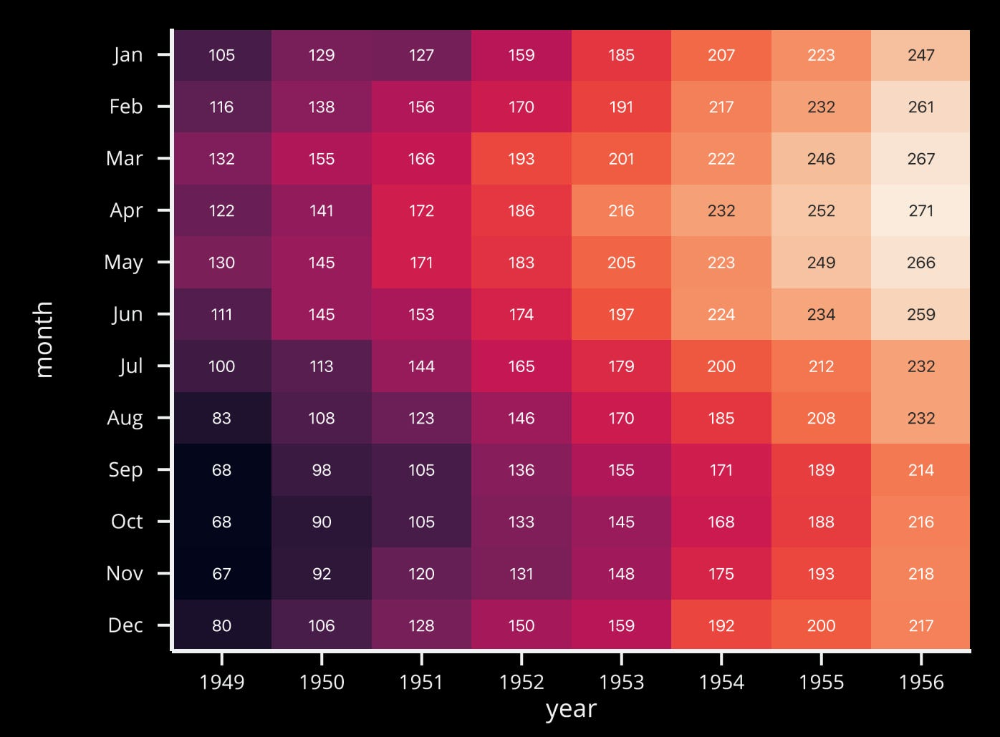

# Annotated heatmap

Display values from a pivoted DataFrame.

**Tags:** `statistical-plots`, `heatmap`



[View the source file on GitHub](https://github.com/lukasz-migas/napari-plot/blob/main/examples/stats_heatmap.py)

## Python example

```python
"""Annotated heatmap
=============

Display values from a pivoted DataFrame.

.. tags:: statistical-plots, heatmap"""

import numpy as np
import pandas as pd

import napari_plot

rng = np.random.default_rng(6)
months = ["Jan", "Feb", "Mar", "Apr", "May", "Jun", "Jul", "Aug", "Sep", "Oct", "Nov", "Dec"]
years = list(range(1949, 1957))
passengers = pd.DataFrame(
    [
        [100 + 20 * (year - 1949) + 30 * np.sin(m / 12 * 2 * np.pi) + rng.normal(0, 5) for year in years]
        for m in range(12)
    ],
    index=pd.Index(months, name="month"),
    columns=pd.Index(years, name="year"),
)

viewer = napari_plot.Viewer()
viewer.heatmap(passengers, annot=True, fmt=".0f")

if __name__ == "__main__":
    napari_plot.run()
```
