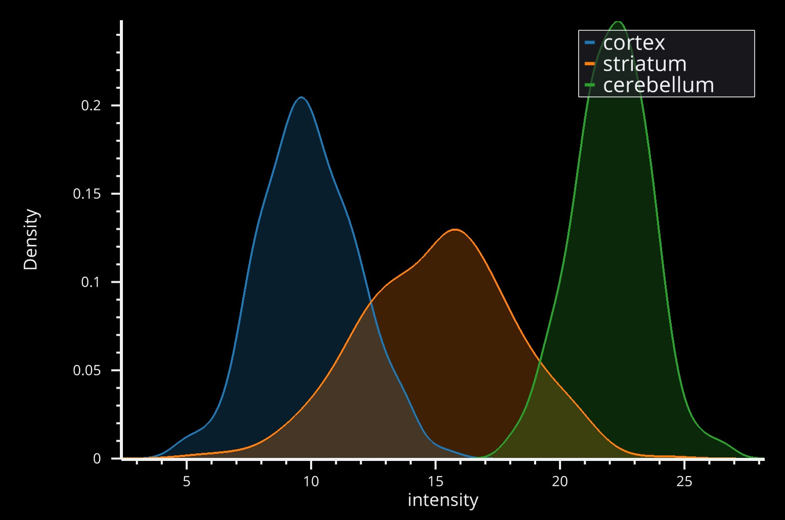

# Kernel density plots

Filled kernel density estimates and a classic distplot-style rug.

**Tags:** `statistical-plots`, `kde`



[View the source file on GitHub](https://github.com/lukasz-migas/napari-plot/blob/main/examples/stats_kdeplot.py)

## Python example

```python
"""Kernel density plots
=============

Filled kernel density estimates and a classic distplot-style rug.

.. tags:: statistical-plots, kde
"""

import numpy as np
import pandas as pd

import napari_plot

rng = np.random.default_rng(5)
frame = pd.DataFrame(
    {
        "intensity": np.concatenate((rng.normal(10, 2, 400), rng.normal(15, 3, 400), rng.normal(22, 1.5, 200))),
        "tissue": ["cortex"] * 400 + ["striatum"] * 400 + ["cerebellum"] * 200,
    }
)

viewer = napari_plot.Viewer()
viewer.kdeplot(frame, x="intensity", hue="tissue", fill=True, common_norm=False)

if __name__ == "__main__":
    napari_plot.run()
```
