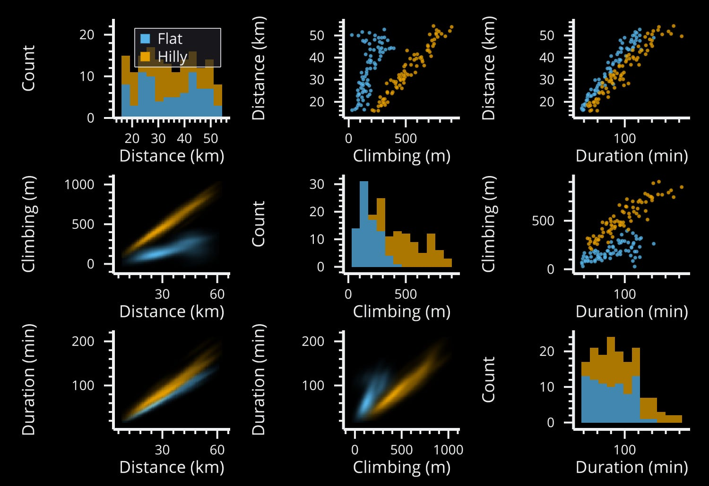

# Pair grid

Compare ride distance, climbing, and duration across two cycling route types.

**Tags:** `statistical-plots`, `pair-grid`



[View the source file on GitHub](https://github.com/lukasz-migas/napari-plot/blob/main/examples/stats_pairgrid.py)

## Python example

```python
"""Pair grid
==============

Compare ride distance, climbing, and duration across two cycling route types.

.. tags:: statistical-plots, pair-grid
"""

import numpy as np
import pandas as pd

import napari_plot
from napari_plot.stats import PairGrid, histplot, kdeplot, scatterplot

rng = np.random.default_rng(24)
routes = np.repeat(["Flat", "Hilly"], 80)
hilly = routes == "Hilly"
distance = rng.uniform(15, 55, routes.size)
speed = np.where(hilly, 21, 27) + rng.normal(0, 2.2, routes.size)
climb_per_km = np.where(hilly, 15, 5) + rng.normal(0, 1.5, routes.size)
data = pd.DataFrame(
    {
        "Distance (km)": distance,
        "Climbing (m)": distance * climb_per_km,
        "Duration (min)": 60 * distance / speed,
        "Route": routes,
    }
)
palette = {"Flat": "#56b4e9", "Hilly": "#e69f00"}
bins = 12

viewer = napari_plot.Viewer(title="Cycling rides by route type")
viewer.window.resize(1100, 800)
viewer.margins = (0.08, 0.08)

grid = PairGrid(viewer, data, hue="Route")
grid.map_upper(scatterplot, palette=palette, marker_size=5, opacity=0.8)
grid.map_lower(kdeplot, palette=palette, gridsize=64, cut=1.5)
grid.map_diag(histplot, palette=palette, bins=bins, multiple="stack")

# Leave room above the first histogram for the shared legend.
peak_count = np.histogram(distance, bins=bins)[0].max()
viewer.canvas.grid.cell(0, 0).ylim = (0, 1.4 * peak_count)
viewer.legend.gridded = False
viewer.legend.font_size = 9

if __name__ == "__main__":
    napari_plot.run()
```
