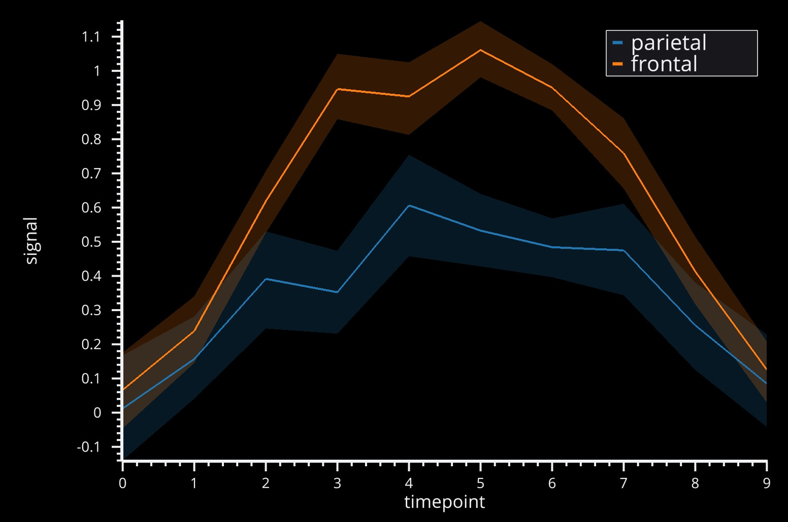

# Relational plots

Relational plots: a scatter with hue/size/style semantics and an aggregated line with CI band.

**Tags:** `statistical-plots`, `relational`



[View the source file on GitHub](https://github.com/lukasz-migas/napari-plot/blob/main/examples/stats_relplot.py)

## Python example

```python
"""Relational plots
=============

Relational plots: a scatter with hue/size/style semantics and an aggregated line with CI band.

.. tags:: statistical-plots, relational
"""

import numpy as np
import pandas as pd

import napari_plot

rng = np.random.default_rng(8)
timepoints = np.tile(np.arange(10), 40)
region = np.repeat(rng.choice(["frontal", "parietal"], 40), 10)
signal = np.sin(timepoints / 3) * np.where(region == "frontal", 1.0, 0.6) + rng.normal(0, 0.25, timepoints.size)
fmri = pd.DataFrame({"timepoint": timepoints, "signal": signal, "region": region})

viewer = napari_plot.Viewer()
viewer.relplot(fmri, x="timepoint", y="signal", hue="region", kind="line", seed=0)

if __name__ == "__main__":
    napari_plot.run()
```
