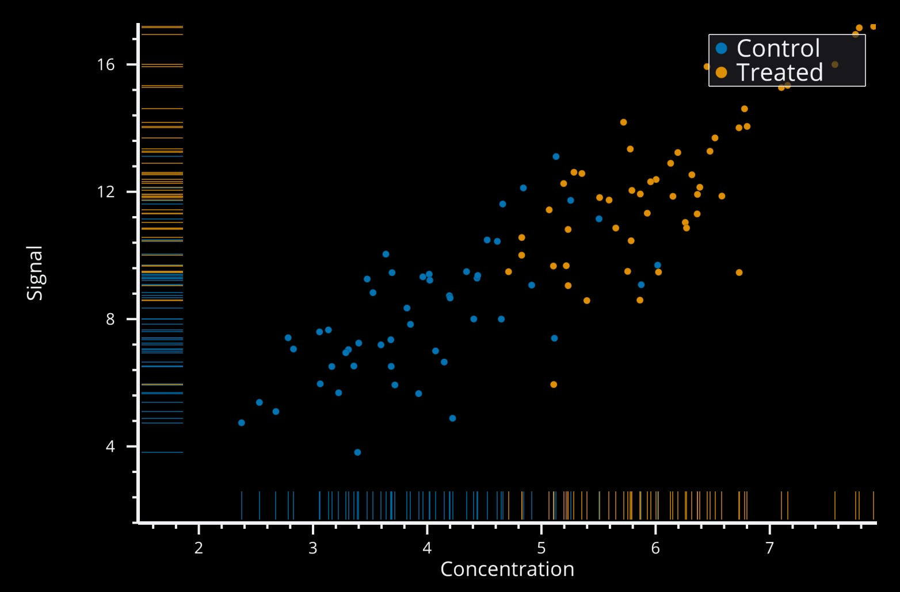

# Rug plots

Overlay hue-colored rug ticks along both axes of a scatter plot.

**Tags:** `statistical-plots`, `rug`



[View the source file on GitHub](https://github.com/lukasz-migas/napari-plot/blob/main/examples/stats_rugplot.py)

## Python example

```python
"""Rug plots
=============

Overlay hue-colored rug ticks along both axes of a scatter plot.

.. tags:: statistical-plots, rug
"""

import numpy as np
import pandas as pd

import napari_plot

rng = np.random.default_rng(9)
concentration = np.concatenate((rng.normal(4, 0.8, 50), rng.normal(6, 0.8, 50)))
frame = pd.DataFrame(
    {
        "Concentration": concentration,
        "Signal": 2 * concentration + rng.normal(0, 1.5, concentration.size),
        "condition": ["Control"] * 50 + ["Treated"] * 50,
    }
)
semantics = {"x": "Concentration", "y": "Signal", "hue": "condition", "palette": "colorblind"}

viewer = napari_plot.Viewer()
viewer.scatterplot(frame, **semantics)
viewer.rugplot(frame, height=0.05, alpha=0.7, legend=False, **semantics)

if __name__ == "__main__":
    napari_plot.run()
```
