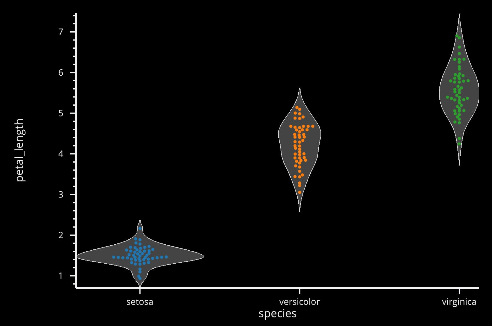

# Swarm plots

Swarm plot over a violin: every observation without overlap.

**Tags:** `statistical-plots`, `swarm`



[View the source file on GitHub](https://github.com/lukasz-migas/napari-plot/blob/main/examples/stats_swarmplot.py)

## Python example

```python
"""Swarm plots
===============

Swarm plot over a violin: every observation without overlap.

.. tags:: statistical-plots, swarm
"""

import numpy as np
import pandas as pd

import napari_plot

rng = np.random.default_rng(3)
species = np.repeat(["setosa", "versicolor", "virginica"], 50)
petal_length = np.concatenate((rng.normal(1.5, 0.2, 50), rng.normal(4.3, 0.5, 50), rng.normal(5.5, 0.55, 50)))
iris = pd.DataFrame({"species": species, "petal_length": petal_length})

viewer = napari_plot.Viewer()
viewer.violinplot(iris, x="species", y="petal_length", inner=None, color="#444444")
viewer.swarmplot(iris, x="species", y="petal_length", hue="species", size=5)

if __name__ == "__main__":
    napari_plot.run()
```
